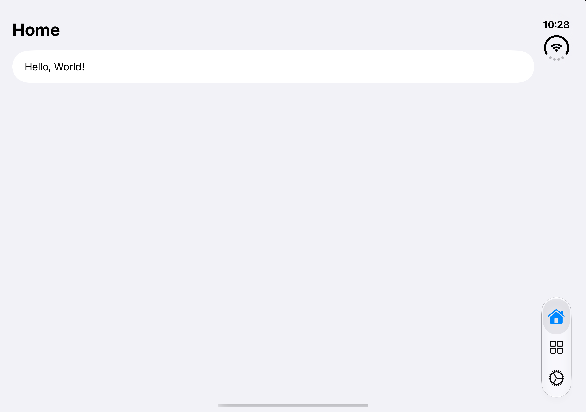
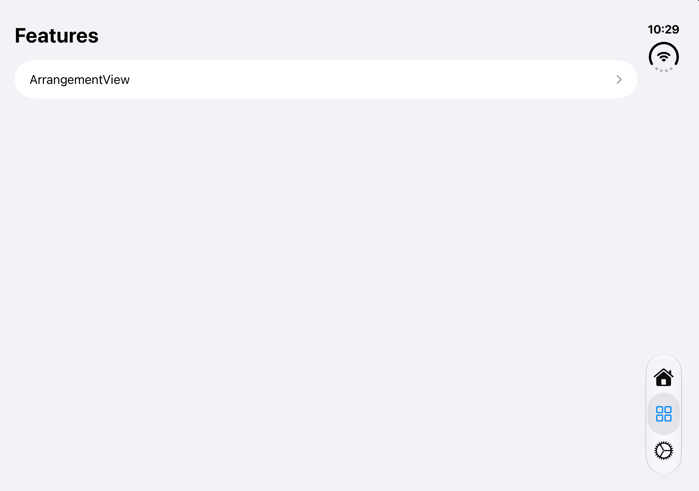
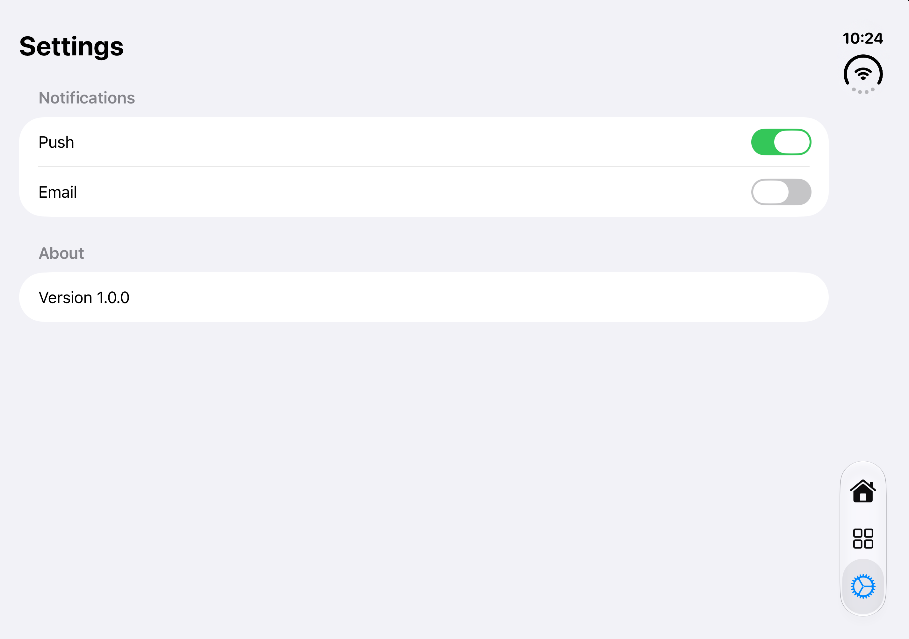

# Minimal Expo Starter

A personal Expo SDK 58 starter for native iOS and Android apps.

<p align="center">
  
  
  
</p>

## Included

- Expo Router with native tabs
- Independent stacks for Home, Features, and Settings
- ArrangementView split-layout demo on iOS 27.1 and later, with a fallback message on other platforms
- Large navigation titles on iOS
- Universal `@expo/ui` components backed by SwiftUI and Jetpack Compose
- Strict TypeScript, typed routes, React Compiler, and ESLint

## Requirements

- Node.js 22.13+, 24.3+, or 26+ (odd-numbered releases are unsupported)
- Bun
- Xcode for iOS development
- Android Studio for Android development

## Get started

Install dependencies:

```bash
bun install
```

Start the Expo development server:

```bash
bun start
```

Build and run a native app:

```bash
bun run ios
bun run android
```

## Quality checks

```bash
bun run lint
bun run typecheck
bun run check
```

## Routes

```text
src/app/
├── _layout.tsx
├── (home)/
│   ├── _layout.tsx
│   └── index.tsx
├── features/
│   ├── _layout.tsx
│   ├── index.tsx
│   ├── arrangement-view.ios.tsx
│   └── arrangement-view.tsx
└── settings/
    ├── _layout.tsx
    └── index.tsx
```

- `/` — Home
- `/features` — Features
- `/features/arrangement-view` — ArrangementView demo
- `/settings` — Settings

## Create a new app

After copying this starter, update:

- `name` in `package.json`
- `name`, `slug`, and `scheme` in `app.json`
- `ios.bundleIdentifier` and `android.package` in `app.json`
- App icons and splash screen assets

Then remove or replace the example Home, Features, and Settings content.
